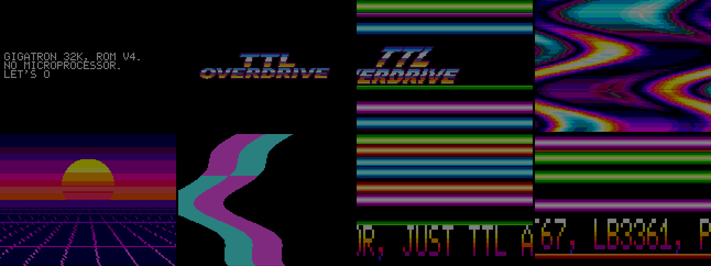

# TTL OVERDRIVE

A demo for the 32K Gigatron with ROM v4: 1 minute 42 seconds of copper bars behind a
wobbling logo, a full-screen plasma, a synthwave sunset over a perspective grid, a
twister and a greetings scroller, on an original 4-channel soundtrack, with the
blinkenlights on the drums.

## Files

| File | |
|---|---|
| `overdrive.gt1` | 32K Gigatron, ROM v4 |

Load it like any other GT1 (Loader with BabelFish and `sendFile.py`, or an emulator).
It starts by itself; plug in a speaker for the sound.

## How it works

Nothing is computed per pixel. Every effect is a choice of page and horizontal offset
for each of the 120 rows of the videoTable, written in one pass from the top of the
frame. 32 full pages are filled at the start of each scene with `SYS_SetMemory`
(plasma colour cycles, twister slices, grid lines at 24 depths); the plasma and the
twister run at 60 frames per second in video mode 2. The copper bars are drawn with
`SYS_Sprite6` used as a 6-byte blitter. The music player, in vCPU assembly, drives the
four sound channels with envelopes (the clip level of `wavA` as a volume), arpeggios,
vibrato and noise drums in 18 % of a frame.

## Source

C and vCPU assembly (built with glcc), the music and graphics generators, and a
headless cycle-exact Gigatron that records picture, sound and LEDs:
https://github.com/storagebits/ttl-overdrive

Directed by storagebits. MIT license, see `LICENSE`.
