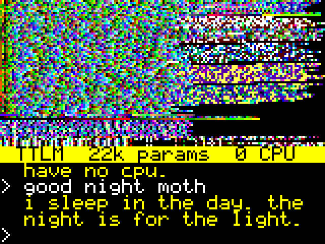
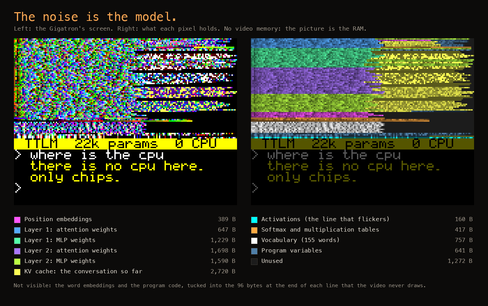

# TTLM: Transistor-Transistor Language Model

A tiny language model that runs on the Gigatron: a real decoder-only transformer
(2 layers, width 32, 2 heads, context of 20 words, 155-word vocabulary) with
21,984 ternary weights (-1, 0, +1). Inference uses integers only: no multiplier
in the linear layers, power-of-two norms and scales, a table-driven softmax and
quarter squares for attention.

It plays the moth found in a Harvard Mark II relay in 1947. It knows about light,
dust and warm chips, and not much else.

```
> where is the cpu
  there is no cpu here. the chips do the work.
> do you like the dark
  oh no. please keep the screen on.
```



## Files

| File | |
|---|---|
| `ttlm.gt1` | 32K Gigatron, ROM v4 |
| `ttlm_v3.gt1` | 32K Gigatron, ROM v3 (experimental) |

Load it like any other GT1 (Loader with BabelFish and `sendFile.py`, or an
emulator). Type a question of up to 7 words with a PS/2 keyboard or through
BabelFish, then press Enter. The moth thinks for a while, then answers one word
at a time: about half a token per second, 25 to 35 seconds for a typical
exchange. If nobody types for 30 seconds, it starts a conversation with itself.

## The model is on the screen

With the screen taking 19 KB of the 32 KB, the weights, embeddings and KV cache
live in the top rows of the picture, so the colored noise at the top *is* the
model. The word embeddings and the code sit in the 96 bytes past the end of each
line that the video never draws. While thinking, the program switches to the
video mode that draws one scanline in four, to give the model more time.



## Source

Training (PyTorch), the integer reference, the C and vCPU assembly sources
(built with glcc) and a browser version are in
https://github.com/storagebits/ttlm. The C version running on a Gigatron
simulator is checked bit for bit against the Python reference.

You can also try it in the browser, on Philip Thomas' simulator:
https://storagebits.github.io/ttlm/

MIT license, see `LICENSE`.
